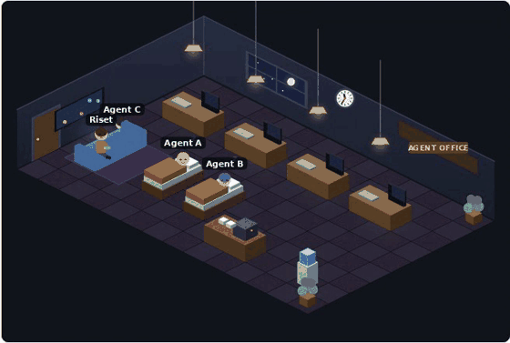
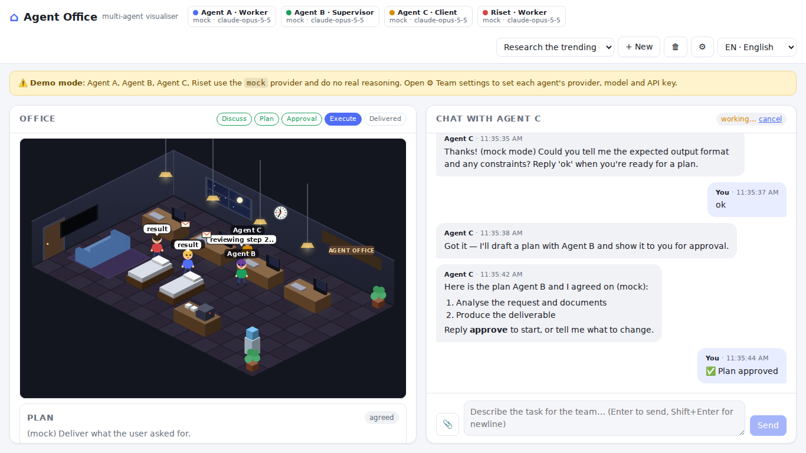
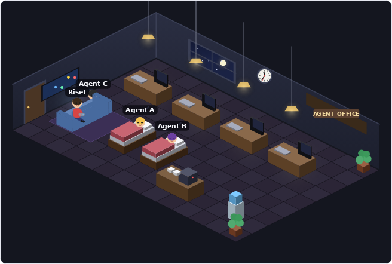
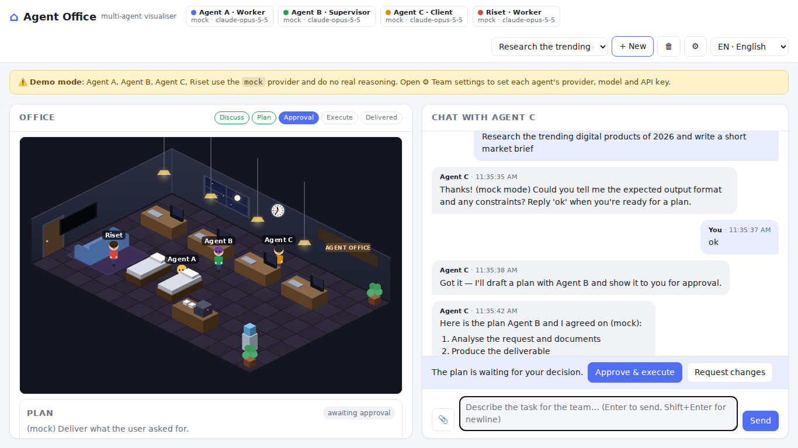
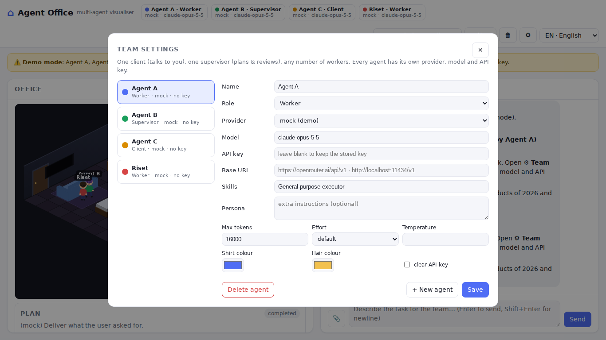

# Agentorium — the office where your agents live

<p align="center"></p>

**A live 2D office that visualises any multi-agent workflow.** Each agent is a character:
when it has work it walks to its desk and types, when it's idle it sleeps, plays games on the
sofa, grabs a coffee or chats at the water cooler. Messages between agents fly across the room
as envelopes, and you can chat with the team from the same page.

Two ways to use it:

1. **Visualise your own workflow** (LangGraph, CrewAI, AutoGen, OpenAI Agents SDK, Claude Agent
   SDK, a plain Python loop…). Push a handful of events over HTTP with the tiny client in `sdk/`.
2. **Use the built-in team.** A client / supervisor / worker workflow with real LLM calls that you
   configure entirely from the web UI (any number of workers, each with its own provider, model and
   API key).

> Status: early release — API shapes may still change. Feedback and adapters for other frameworks are very welcome, see [CONTRIBUTING.md](CONTRIBUTING.md).

## Screenshots

| Task running: workers at their desks, supervisor reviewing | Break time: sleeping, gaming, coffee |
|---|---|
|  |  |

| Plan agreed with the supervisor, waiting for your approval | Team settings: any number of agents, each with its own provider & key |
|---|---|
|  |  |

## Quick start

```bash
git clone <this repo> && cd agentorium
python3 -m venv .venv && source .venv/bin/activate
pip install -r requirements.txt
./run.sh                      # or: uvicorn agentorium.server:app --port 8000
```

Open <http://127.0.0.1:8000>. The three starter agents use the **mock** provider, so you can click
through the whole workflow with no API keys; a yellow banner reminds you until you configure real
providers in **⚙ Team settings**.

## Visualise your own workflow

```python
import sys; sys.path.insert(0, "path/to/agentorium/sdk/python")
from agentorium import Office

office = Office("http://127.0.0.1:8000")
s = office.session("My LangGraph run")
s.register("planner", "Planner", role="supervisor", color="#1a9f5c")
s.register("coder", "Coder", role="worker", skills="python")

s.status("coder", "writing code")      # Coder walks to the desk and types
s.flow("planner", "coder", "task")     # envelope from Planner to Coder
s.say("coder", "Here is the patch…")   # shows up in the chat panel
s.status("coder", "idle")              # back to the lounge

for message in s.user_messages():      # whatever the user types in the chat panel
    ...
```

The same calls exist in `sdk/js/agentorium.js`. `examples/external_workflow.py` is a complete
runnable example. Everything is best-effort: a visualiser that is down must never break your
workflow, so failures are logged, not raised (pass `strict=True` to change that).

### Event protocol

`POST /api/sessions/{id}/events` with one event or `{"events": [...]}`; sessions are created with
`POST /api/sessions {"kind": "external", "title": "..."}`. Set `OFFICE_API_TOKEN` to require an
`X-Office-Token` header on these calls.

| type | fields | effect |
|------|--------|--------|
| `register_agent` | `id`, `name`, `role`, `color`, `hair`, `skills` | adds a character and a desk |
| `agent_status` | `agent`, `status` | `idle` → lounge; any other text → desk + speech bubble |
| `flow` | `source`, `target`, `label` | envelope animation (`user` = the door) |
| `chat` | `agent`, `role`, `content` | message in the chat panel |
| `stage` | `stage` | stepper: discussing · planning · awaiting_approval · executing · done |
| `plan` | `plan: {objective, steps[], acceptance_criteria[], assumptions[]}` | plan card |
| `step` / `review` / `output` | `step_id`, `status` / `verdict`, `score`, `feedback` / `output` | progress per step |
| `note`, `error`, `busy` | `message` / `busy` | activity log, busy indicator |

Inbound: `GET /api/sessions/{id}/events` is a Server-Sent Events stream (snapshot first, then every
event, including the user's chat messages and uploaded documents, whose text is available at
`GET /api/sessions/{id}/documents/{doc_id}/text`).

## The built-in team

| Role | Count | What it does |
|------|-------|--------------|
| **Client** | 1 | The only agent that talks to you. Clarifies, agrees the plan with the supervisor, asks for your approval, delivers. |
| **Supervisor** | 1 | Turns the request into a plan, assigns each step to the best-suited worker (by their *skills*), reviews every result, sends back weak work with feedback. |
| **Worker** | 1…n | Executes steps. Independent steps run in parallel. |

Flow: you ⇄ client → supervisor drafts the plan → client reviews it → **you approve** → workers
execute in dependency waves, supervisor reviews (up to `OFFICE_MAX_REVISIONS` revisions per step)
→ client delivers. Upload **PDF, DOCX, XLSX, TXT/MD** in the chat and every agent can read them.

Agents are edited in **⚙ Team settings** and stored in `data/agents.json` (git-ignored, contains
API keys). Per agent: name, role, provider (`anthropic` via the official SDK, `openai` for any
OpenAI-compatible endpoint such as OpenRouter, Nous Portal, Groq, Ollama, LM Studio, vLLM, or
`mock`), model, API key, base URL, skills, persona, max tokens, effort (Anthropic), temperature.
`.env.example` shows how to seed the first three agents from environment variables.

## Settings (`.env`)

| Variable | Default | Meaning |
|----------|---------|---------|
| `OFFICE_HOST` / `OFFICE_PORT` | `127.0.0.1` / `8000` | bind address |
| `OFFICE_LANG` | `id` | default UI language (`id` / `en`), mock replies, system notes |
| `OFFICE_MAX_REVISIONS` | `2` | how often the supervisor may send a step back |
| `OFFICE_DOC_MAX_CHARS` | `60000` | per-document text injected into prompts |
| `OFFICE_ANTHROPIC_FALLBACKS` | `1` | server-side refusal fallbacks on supported Claude models |
| `OFFICE_API_TOKEN` | empty | shared secret for the external events API |
| `OFFICE_DATA_DIR` | `./data` | sessions, uploads, agents.json |

**Security note:** there is no login. Bind to `127.0.0.1` or put it behind a reverse proxy with
authentication before exposing it on a network; `data/agents.json` contains API keys.

## Layout

```
agentorium/
  config.py        server settings + env seeding
  registry.py      editable agent roster (roles, providers, keys) → data/agents.json
  llm.py           anthropic / openai-compatible / mock clients
  agents.py        role personas, prompt builders, JSON extraction
  orchestrator.py  sessions, event bus, built-in workflow, external event ingest
  documents.py     text extraction for uploads
  server.py        FastAPI routes + SSE
web/               static UI (no build step); scene.js = the isometric office
sdk/python, sdk/js client libraries for external workflows
examples/          runnable external workflow
data/              runtime state (git-ignored)
```

## License

MIT
